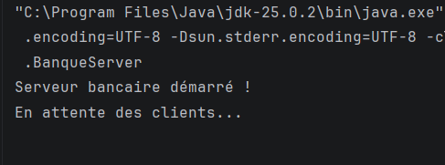
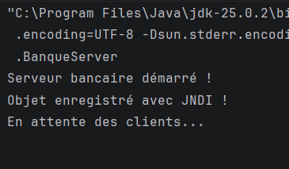

# TP 5 : Invocation des méthodes sur des objets distants avec Java RMI

## Activité 5-2 : Service de banque en utilisant RMI et JNDI

**Réalisé par :** Gharbi Yesmine  
**Niveau :** LSI3  
**Module :** Développement d'applications réparties

---

## 1. Présentation du TP

L'objectif de ce TP est de développer une application répartie de gestion de comptes bancaires en utilisant Java RMI et JNDI.

L'application permet à un client de communiquer avec un serveur distant afin de réaliser deux opérations principales :

- Créer un compte bancaire avec un code et un solde initial.
- Consulter les informations d'un compte à partir de son code.

Un compte bancaire est caractérisé par trois attributs : un code, un solde et une date de création.


### Structure du projet

```text
GharbiYesmine_LSI3_TP5_RMI_JNDI/
│
├── RMIBanque_Server/
│   └── src/
│       ├── metier/
│       │   └── Compte.java
│       │
│       ├── rmiService/
│       │   ├── IBanque.java
│       │   └── BanqueImpl.java
│       │
│       ├── rmiServer/
│       │   └── BanqueServer.java
│       │
│       └── jndi.properties
│
├── RMIBanque_Client/
│   └── src/
│       ├── rmiClient/
│       │   └── BanqueClient.java
│       │
│       └── jndi.properties
│
├── banqueClient.jar
├── cap/
└── README.md
```

## 2. Exécution de l'application

### 2.1. Exécution du serveur

Nous commençons par démarrer l'application `BanqueServer`.

Le serveur crée le registre RMI sur le port 1099, initialise le service bancaire et enregistre l'objet distant avec JNDI.

**Capture d'écran :**



### 2.2. Exécution du client

Après le démarrage du serveur, nous exécutons l'application `BanqueClient`.

Le client effectue plusieurs opérations afin de vérifier le bon fonctionnement du service bancaire :

- Création d'un compte avec le code 100 et un solde initial de 5000 DT.
- Consultation des informations du compte 100.
- Tentative de création d'un compte avec un code déjà existant.
- Consultation d'un compte inexistant avec le code 200.

**Capture d'écran :**




## 3. Conclusion

Ce TP nous a permis de mettre en pratique la communication entre applications Java réparties à travers la technologie RMI.

Nous avons appris à créer des objets sérialisables, à définir une interface distante, à implémenter un service bancaire et à effectuer des appels de méthodes à distance.

Nous avons également découvert l'intégration de JNDI avec RMI pour faciliter l'enregistrement et la recherche des objets distants à travers un service d'annuaire.

Ce travail nous a permis de mieux comprendre le fonctionnement d'une architecture client/serveur et les mécanismes de communication entre applications Java réparties.